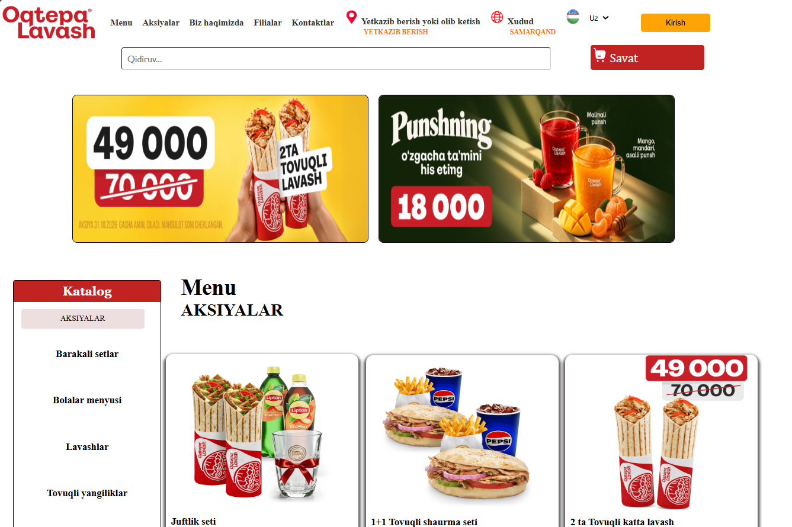

<div align="center">
  <h1 align="center">🍔 Oqtepa Lavash Clone</h1>
  <p align="center">
    Oqtepa Lavash yetkazib berish rasmiy veb-saytining kloni (Frontend loyiha)
  </p>
  
  <p align="center">
    
    
    
  </p>
</div>

---

## 📋 Loyiha haqida

Ushbu loyiha Oqtepa Lavash tez ovqatlanish shoxobchasining veb-sayti dizayni va funksionalligiga asoslangan holda yaratilgan frontend ilova hisoblanadi. Unda foydalanuvchilar menyu bo'limlari bilan tanishishi, aksiyalar va turli xil setlarni ko'rishi mumkin.

 

## ✨ Asosiy xususiyatlar

 - **Navigatsiya va Header:** Hududni tanlash, tilni o'zgartirish (UZ), yetkazib berish turini tanlash va qidiruv paneli.
 - **Bannerlar slayderi:** Joriy aksiya va chegirmalar aks etuvchi asosiy banner qismi.
 - **Chap Katalog menyusi:** "Aksiyalar", "Wyгодные сеты", "Lavash", "Burgerlar", "Donar" va boshqa turkumlar bo'yicha qulay filtrlash.
 - **Mahsulotlar kartochkasi:** Mahsulot rasmi, narxi (eskirgan va chegirmadagi narxlar taqqoslanyapti) hamda "Qo'shish" tugmasi.
 - **Moslashuvchan dizayn (Responsive):** Har xil turdagi ekranlarga moslashtirilgan interfeys.

## 🛠 Ishlatilgan texnologiyalar

* **HTML5** — Sahifa strukturasi uchun
* **CSS3** — Stilizatsiya va dizayn uchun

## 📂 Loyiha tuzilmasi

```text
oqtepa-lavash-clone/
│
├── index.html       # Asosiy HTML sahifa
├── style.css        # Asosiy dizayn fayllari
└── images/          # Rasmlar va ikonka papkasi
